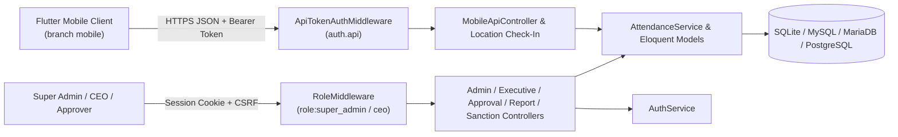

# Arsitektur Monorepo — Presensi Makerindo

## 1. Ringkasan Desain

Project **Presensi Makerindo** menggabungkan Web Portal, Backend REST API, dan Aplikasi Mobile dalam satu repository GitHub (`NabilahSri/presensi_makerindo_mobile`) dengan pemisahan branch yang tegas:

- **Track Server (`main` & `staging-main` — lokal di `D:\presensi_makerindo\main`):**
  - Berisi workspace `apps/server` (Laravel 13 monolith yang melayani Web Dashboard berbasis Blade + Tailwind CSS v4 + Vite 8 dan REST API untuk klien mobile).
- **Track Mobile (`mobile` & `staging-mobile` — lokal di `D:\presensi_makerindo\mobile`):**
  - Berisi project Flutter (`presensi_makerindo`) tepat di root branch agar kompatibel langsung dengan Flutter CLI, Android Studio, dan Xcode.

---

## 2. Alur Kerja Git (2-Track dengan Staging Branch)

```text
Server : [feat|fix|chore|docs/*] ──PR──► [staging-main]   ──Promotion PR──► [main]   (Web & API)
Mobile : [feat|fix|chore|docs/*] ──PR──► [staging-mobile] ──Promotion PR──► [mobile] (Flutter App)
```

- Gunakan branch kerja (`feat/<nama-fitur>`, `fix/<nama-bug>`, dll.) dari `origin/staging-main` untuk perubahan Web/Backend dan targetkan PR ke `staging-main`.
- Gunakan branch kerja (`feat/mobile-<nama-fitur>`, `fix/mobile-<nama-bug>`, dll.) dari `origin/staging-mobile` untuk perubahan Flutter dan targetkan PR ke `staging-mobile`.
- Setelah QC pada branch staging selesai, lakukan Promotion PR (`staging-main -> main` atau `staging-mobile -> mobile`) menggunakan `scripts/promote.ps1` atau `scripts/promote.sh`.
- Jangan pernah menggabungkan `mobile`/`staging-mobile` ke `main`/`staging-main` atau sebaliknya.

---

## 3. Arsitektur Komponen Server (`apps/server`)



### Pemisahan Akses Portal Web vs Mobile
- `User::canAccessWebPortal()` mengizinkan `super_admin` dan `ceo` (plus rute `/approvals` untuk user berhak `can_approve_leaves` atau `super_admin`).
- `User::canAccessMobileApp()` mengizinkan `karyawan` dan `intern` melalui token `PersonalAccessToken` (SHA-256 hash di tabel `personal_access_tokens`).

---

## 4. Komunikasi Mobile <-> Backend

Aplikasi mobile (`lib/services/api_service.dart` di branch `mobile`) terhubung ke Laravel REST API (`apps/server/routes/api.php` dan endpoint `POST /api/attendances/location-check-in` di `apps/server/routes/web.php`):

- **Android Emulator default:** `http://10.0.2.2:8000/api`
- **Desktop / iOS Simulator default:** `http://127.0.0.1:8000/api`
- **Autentikasi:** Bearer Token (`auth.api` middleware via `ApiTokenAuthMiddleware`).
- **Header Anti-Cache:** `NoCacheApiMiddleware` ditambahkan ke seluruh grup rute `api/*`.
