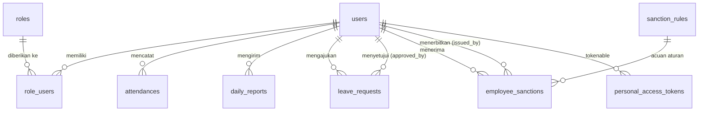

# Skema Database & ERD — Presensi Makerindo

Dokumen ini merangkum struktur tabel aktif pada `apps/server/database/migrations/` setelah penghapusan modul payroll & RFID pada migrasi `2026_11_25_110000_remove_payroll_finance_and_rfid.php`.

## 1. Diagram Relasi Entitas (ERD)

## 2. Daftar Tabel Domain Aktif

| Tabel | Primary Key | Kolom Inti | Keterangan |
|---|---|---|---|
| `users` | `id` (UUID) | `name`, `email` (unique), `profile_photo_path`, `password`, `employment_type` (`KARTAP`, `PKWT`, `INTERN`), `can_approve_leaves` (bool) | Akun pengguna portal & mobile |
| `roles` | `id` (UUID) | `name` (unique: `super_admin`, `ceo`, `karyawan`, `intern`), `display_name`, `is_attendance_required` (bool) | Master peran aplikasi |
| `role_users` | `(user_id, role_id)` | `user_id` (FK), `role_id` (FK) | Pivot many-to-many user <-> role |
| `attendances` | `id` (UUID) | `user_id` (FK), `date`, `time_in`, `time_out`, `status` (`HADIR_ON_SITE`, `WFA`, `TUGAS_LUAR`, `CUTI`, `SAKIT`, `IZIN`, `ALPHA`), `method` (`FACIAL_LOCATION`, `FORM`), `face_image_path`, `checkout_face_image_path`, `latitude`, `longitude`, `checkout_latitude`, `checkout_longitude`, `is_late`, `overtime_hours` | Log presensi masuk & pulang (GPS + foto) |
| `daily_reports` | `id` (UUID) | `user_id` (FK), `date`, `morning_submitted_at`, `morning_planned_tasks`, `evening_submitted_at`, `evening_completed_tasks`, `evening_pending_tasks`, `evening_additional_tasks`, `status` (`MORNING_ONLY`, `COMPLETED`) | Laporan tugas pagi & sore |
| `leave_requests` | `id` (UUID) | `user_id` (FK), `type` (`SAKIT`, `IZIN`, `WFA`, `CUTI`, `TUGAS_LUAR`), `start_date`, `end_date`, `reason`, `attachment_path`, `status` (`PENDING`, `APPROVED`, `REJECTED`), `approved_by` (FK nullable), `rejection_reason` | Pengajuan & persetujuan izin |
| `sanction_rules` | `id` (UUID) | `code` (unique), `name`, `category` (`DISIPLIN_WAKTU`, `KEHADIRAN`, `KINERJA_TUGAS`, `ETIKA_SOP`), `trigger_type` (`AUTO_LATE`, `AUTO_ALPHA`, `MANUAL`), `threshold_count`, `default_level`, `description`, `is_active` | Aturan deteksi & level sanksi |
| `employee_sanctions` | `id` (UUID) | `user_id` (FK), `sanction_rule_id` (FK nullable), `issued_by` (FK nullable), `month`, `year`, `incident_date`, `violation_name`, `level` (`TEGURAN_LISAN`, `SP1`, `SP2`, `SP3`), `source` (`AUTO_DETECTED`, `MANUAL`), `occurrence_count`, `reason`, `status` (`ACTIVE`, `RESOLVED`, `REVOKED`) | Catatan sanksi pegawai |
| `holidays` | `id` (UUID) | `date` (unique), `name`, `type` (`NASIONAL`, `CUTI_BERSAMA`, `INTERNAL`) | Kalender hari libur kerja |
| `settings` | `id` (UUID) | `key` (unique), `value` | Pengaturan branding, jam kerja, & geofence kantor |
| `personal_access_tokens` | `id` (bigint) | `tokenable_type`, `tokenable_id` (UUID morph), `name`, `token` (SHA-256, 64 char unique), `abilities`, `last_used_at`, `expires_at` | Bearer token klien mobile |

*Tabel sistem Laravel standar: `sessions`, `password_reset_tokens`, `cache`, `cache_locks`, `jobs`, `job_batches`, `failed_jobs`.*
*Catatan migrasi: Tabel `payrolls`, `project_incentives`, `devices`, serta kolom `rfid_uid`, `basic_salary`, `bank_*`, dan `deduction_amount` telah dihapus oleh migrasi `2026_11_25_110000_remove_payroll_finance_and_rfid.php`. Pada driver SQLite, enum `attendances.status` dan `leave_requests.type` mengacu pada migrasi `2026_11_27_000001_sync_sqlite_enum_constraints.php`.*
